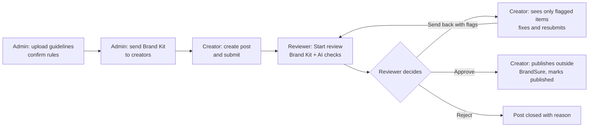
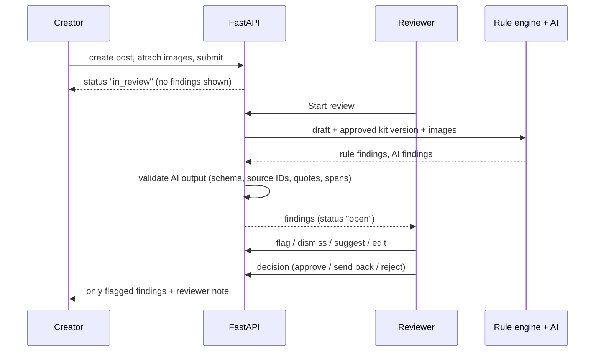

# BrandSure

**Review content before the world does.**

BrandSure is a brand-governance web application. An organisation turns its brand guidelines into an approved **Brand Kit**; creators write posts; reviewers check each post against that kit with evidence-backed findings; and a person, not the software, approves what goes out.

| | |
|---|---|
| **Live demo** | `https://brand-sure.vercel.app` |
| **Repository** | `https://github.com/hrx0508/BrandSure` |
| **Type** | Full-stack web application (React single-page app + FastAPI REST API) |
| **Status** | Working prototype built for a hackathon round (see [Limitations](#limitations-and-known-issues)) |

---

## Table of contents

[Preview](#visual-preview) · [Overview](#project-overview) · [Problem](#problem-statement) · [Solution](#solution-and-approach) · [Features](#key-features) · [What is distinctive](#innovation-and-unique-value) · [How it works](#how-it-works) · [Tech stack](#technology-stack) · [Structure](#architecture-and-project-structure) · [Getting started](#getting-started) · [Usage](#usage-and-examples) · [API](#api-documentation) · [Security](#security-and-privacy) · [Decisions](#challenges-and-technical-decisions) · [Limitations](#limitations-and-known-issues) · [Roadmap](#future-improvements) · [Testing](#testing-and-quality-assurance) · [Deployment](#deployment) · [Contributing](#contributing) · [License](#license)

---

## Visual preview

No screenshots are committed to this repository yet. The most useful ones to add (for example under `docs/screenshots/`) are:

1. The login page with the one-click demo panel.
2. A creator's post page after the reviewer sent it back, showing the process tracker and the red-flag charts.
3. A reviewer's post page after **Start review**, showing the triage chart and the findings list.
4. The Insights page with its charts.

The workflow diagram below shows the core journey:



---

## Project overview

BrandSure checks content *before* publication against rules the organisation has approved. It has three roles, each with its own screen:

- **Admin** builds and manages the Brand Kit and the team.
- **Creator** writes posts and fixes what the reviewer flags.
- **Reviewer** runs the checks, decides which findings are real, and approves, sends back or rejects.

It is meant for teams where posts come from several people (employees, agencies, freelancers, AI writing tools) and at least one person signs off before publishing.

BrandSure does not publish anything and does not guarantee legal compliance. "No issues detected" means only that the configured checks found nothing.

---

## Problem statement

When many people and tools produce content, small inconsistencies slip out: the company name spelled several ways, an offer advertised after it expired, a ranking claim with no evidence, an image without alt text. These problems damage credibility and are easy to miss in a manual review because the reviewer has to remember every rule.

This project is a response to a hackathon problem statement (an "intelligent brand-governance platform"). It was built from that brief; the project does not include its own market research, and none is claimed here.

---

## Solution and approach

1. **Make the rules explicit and approved.** Guidelines are uploaded and turned into *candidate* rules, each with the exact sentence it came from. Nothing becomes a rule until an admin confirms it.
2. **Check with code first.** Exact rules (terms, dates, required wording) are checked by ordinary deterministic code, so the same input gives the same result.
3. **Use AI only for judgement, and verify it.** Optional AI handles things like tone and whether a claim is supported. Every AI answer is validated against the approved kit before anyone sees it.
4. **Keep people in charge.** The reviewer decides which findings are real; creators see only those; a reviewer approves one exact version; every action is recorded.

---

## Key features

All features below are implemented in the code. Optional ones are marked.

### Admin
- Upload guidelines as **PDF, DOCX, or a Google Doc link** (the doc must be shared as "Anyone with the link can view"). Scanned PDFs are read with **OCR** *(optional: needs Tesseract installed)*.
- Review proposed rules next to their source quotes; edit, reject, add rules manually, then confirm. Each confirmation creates a new **version**.
- **Send the Brand Kit to creators.** Creators cannot see or use a kit until it is sent.
- **Make a kit inactive**, reactivate it, or delete it (deletion is refused if any post used the kit).
- Add creators and reviewers to the team; see Insights; open any post read-only.

### Creator
- Create a post by writing text, uploading DOCX/PDF, or importing a Google Doc; attach images (up to 5 per version) and add alt text.
- Submit to a named reviewer or "any reviewer".
- See **only what the reviewer flagged**, with a "fixed out of total" ring, a severity donut and a by-type bar chart.
- Accept a suggestion, edit the text, or mark a flag as fixed; save corrections as a new version; resubmit. Earlier versions are always kept.
- Mark an approved post as published (a record only).

### Reviewer
- A review queue and a to-do list. **Start review** runs the checks on the submitted version.
- **Flag** a finding for the creator or **dismiss** it as not an issue; "Flag all open" shortcut.
- Select text and **suggest a replacement**, or **edit the post** directly (saved as a new version marked as the reviewer's).
- **Approve**, **send back with flags**, or **reject** with a reason. Approval requires the review to have been started; approving with open or flagged high-severity findings requires a written reason.

### Checks
- Preferred and banned terms (word-boundary matching, case and spacing variants such as "Tech Nova" for "TechNova").
- Offer validity: expired offers and dates later than the approved date (valid through the end of the day, India time).
- Required disclaimer wording; claim phrases such as "No. 1" flagged as **Unverified** when no approved fact supports them. Missing evidence never becomes "False".
- Images: missing alt text, text/background contrast (WCAG ratio), and an approximate dominant-colour palette check.
- Tone and claim judgement through an LLM *(optional)*, otherwise a built-in offline heuristic.

### Visibility and progress
- A **process tracker** on every post shows the path and whether it is *your move* or you are *waiting for* someone.
- **Home** shows each person their own to-do and waiting-for lists.
- **Insights** (charts from recorded events): issues by category, activity by day, post statuses, reviewer decisions, and rules reviewers dismiss most (a hint that a rule may be unclear).
- Audit history and comments on every post.

### Platform
- Email/password accounts, organisation isolation, role checks on every endpoint.
- Optional **Slack** notifications (titles and statuses only) and optional **Supabase Auth** sign-in.
- One-click **demo mode** with sample data and a role switcher.

---

## Innovation and unique value

These are mechanisms in the code, not claims of novelty:

- **Findings are hidden by role on the server.** Creators receive only findings with status flagged/accepted/edited/resolved. The reviewer is the filter between automated checks and the person who has to act.
- **AI output is treated as untrusted.** `evidence_validator.py` checks structure, that cited source IDs exist in the exact kit version, that quoted text really appears in the source, that the highlighted span exists in the draft, and that the source is relevant to the claim. Anything that fails is rejected or downgraded to *Unverified*.
- **Deterministic first, so it still works offline.** The rule engine and the offline analyzer need no external service. If the AI provider fails, rule findings are still produced.
- **Reviews are pinned to a Brand Kit version**, and drafts are versioned and never overwritten.
- **Small data footprint.** Uploaded files are processed in memory and not kept; only extracted text, confirmed rules and 240 px image thumbnails are stored.

---

## How it works



1. **Extraction.** `document_extractor.py` validates file type, signature and size, extracts text with page/paragraph references (OCR for image-only PDF pages if available).
2. **Candidate rules.** `candidate_extractor.py` proposes rules (LLM if configured, otherwise regex heuristics); every candidate must quote text that really exists in the document.
3. **Analysis.** `review_service.run_analysis` runs `rule_engine` (terms, dates, disclaimers, images), then `ai_analyzer`, then `evidence_validator`, and merges the results.
4. **Workflow.** `reviews.py` (creator side) and `approvals.py` (reviewer side) enforce who may do what and in which status.

---

## Technology stack

| Technology | Purpose | Where or how it is used |
|---|---|---|
| Python 3 | Backend language | `backend/app` |
| FastAPI + Uvicorn | REST API and server | `app/main.py`, `app/api/v1/*` |
| Pydantic v2 | Request/response validation | `app/schemas/*` |
| SQLite (standard library `sqlite3`) | Local database | `app/db/client.py`, `app/repositories/store.py` |
| PyMuPDF | PDF text extraction | `services/document_extractor.py` |
| python-docx | DOCX text extraction (and test fixtures) | `services/document_extractor.py` |
| Pillow | Image validation, dominant colours, thumbnails | `services/image_checker.py` |
| httpx | HTTP calls to optional services | `llm.py`, `gdocs.py`, `notify.py`, `supabase_auth.py` |
| python-multipart | File upload handling | upload endpoints |
| pytest | Tests | `backend/tests` |
| React 18 + Vite 5 | Single-page frontend and dev/build tool | `frontend/src` |
| React Router 6 | Role-aware routing | `frontend/src/app/router.jsx` |
| Tailwind CSS 3 | Styling with theme variables (light/dark) | `frontend/tailwind.config.js`, `styles/index.css` |
| GSAP 3.12.5 | Animations (respects reduced-motion) | `frontend/src/lib/motion.js` and pages |
| Hand-built SVG | Charts (donut, ring, line, bars) | `components/charts/Charts.jsx` |
| LLM API *(optional)* | Tone/claim judgement, rule extraction, alt-text suggestions | `services/llm.py` (Anthropic Messages API format) |
| Tesseract + pytesseract *(optional)* | OCR for scanned PDFs | `document_extractor.py` |
| Slack incoming webhook *(optional)* | Notifications | `services/notify.py` |
| Supabase Auth *(optional)* | Alternative sign-in | `services/supabase_auth.py` |

Standard-library pieces also used: `hashlib.scrypt` for passwords and `hmac` for signed tokens.

---

## Architecture and project structure

A modular monolith: one React app, one FastAPI service, one database.

```text
brandsure/
├── backend/
│   ├── app/
│   │   ├── main.py              # app factory, CORS, /health, router wiring
│   │   ├── api/v1/              # HTTP routes: auth, brand_kits, reviews, approvals,
│   │   │                        #   insights, tasks, integrations, demo
│   │   ├── core/                # config (.env parsing), security (tokens, roles,
│   │   │                        #   rate limit), passwords, error format
│   │   ├── db/client.py         # SQLite schema, in-place upgrades, demo seeding
│   │   ├── repositories/store.py# small data-access helpers
│   │   ├── schemas/             # Pydantic models and allowed values
│   │   └── services/            # rule_engine, ai_analyzer, evidence_validator,
│   │                            #   document_extractor, candidate_extractor,
│   │                            #   image_checker, insights, tasks, demo_data,
│   │                            #   llm, gdocs, notify, supabase_auth, ...
│   ├── tests/                   # 8 test files
│   ├── requirements.txt
│   └── requirements-optional.txt
├── frontend/
│   ├── src/
│   │   ├── app/router.jsx
│   │   ├── components/          # ProcessTracker, charts, layout, UI kit
│   │   ├── features/            # auth, home, brand-kits, posts (creator,
│   │   │                        #   reviewer, admin views), insights, team,
│   │   │                        #   settings, guide, approvals
│   │   └── lib/                 # API client, auth, motion, hooks
│   └── package.json
├── docs/                        # API contract, schema, product spec, test plan,
│                                #   INTEGRATIONS.md
├── samples/                     # fictional TechNova guidelines (.docx) and draft
├── supabase/migrations/0001_init.sql   # PostgreSQL schema (prepared, not wired)
└── .env.example                 # template for backend and frontend settings
```

The database has 13 tables: `organisations`, `profiles`, `brand_kits`, `brand_kit_versions`, `brand_rules`, `documents`, `reviews`, `review_versions`, `findings`, `review_images`, `review_comments`, `approval_events`, `audit_events`.

---

## Getting started

### Prerequisites

- Python 3.10 or newer (the code uses `X | None` type syntax)
- Node.js and npm (for the frontend)
- *Optional:* the Tesseract program, for OCR (see [`docs/INTEGRATIONS.md`](docs/INTEGRATIONS.md))
- *Optional:* an LLM API key, a Slack webhook URL, a Supabase project

No external service is required to run the core workflow.

### Installation

```bash
git clone <your-repository-url>
cd brandsure
```

**Backend**

```bash
cd backend
python -m venv .venv
source .venv/bin/activate          # Windows PowerShell: .\.venv\Scripts\Activate.ps1
pip install -r requirements.txt
cp .env.example .env               # edit values as needed
uvicorn app.main:app --reload --port 8000
```

**Frontend** (second terminal)

```bash
cd frontend
cp .env.example .env               # contains VITE_API_BASE_URL
npm install
npm run dev                        # http://localhost:5173
```

### Configuration

Backend settings live in `backend/.env` (template: `backend/.env.example`). Lines may have trailing `# comments`.

| Variable | Purpose | Default |
|---|---|---|
| `APP_ENV` | `production` requires a real `SECRET_KEY` and turns demo login off unless enabled | `development` |
| `FRONTEND_ORIGIN` | Allowed CORS origin(s), comma separated | `http://localhost:5173` |
| `DB_PATH` | SQLite file | `brandsure.db` (next to `backend/`) |
| `MAX_UPLOAD_MB` | Upload size limit | `10` |
| `SECRET_KEY` | Signs login tokens | dev placeholder; required in production |
| `TOKEN_TTL_HOURS` | Login lifetime | `12` |
| `SEED_DEMO` | Create the demo organisation and 3 accounts on first run | `true` |
| `DEMO_CONTENT` | Load the sample Brand Kit and posts (needs `SEED_DEMO`) | same as `SEED_DEMO` |
| `DEMO_LOGIN` | One-click demo buttons | on in development, off otherwise |
| `ALLOW_REGISTRATION` | Allow creating a new organisation from the login page | `true` |
| `EVAL_DATE` | Fixed date (YYYY-MM-DD) for reproducible date checks | empty (today, India time) |
| `LLM_API_KEY`, `LLM_MODEL`, `LLM_URL` | Optional AI; empty key keeps AI off | model `claude-sonnet-5-5`, URL `https://api.anthropic.com/v1/messages` |
| `SLACK_WEBHOOK_URL` | Optional Slack notifications | empty |
| `OCR_ENABLED`, `OCR_LANG` | OCR for scanned PDFs (needs Tesseract) | `true`, `eng` |
| `AUTH_PROVIDER` | `local` or `supabase` | `local` |
| `SUPABASE_URL`, `SUPABASE_ANON_KEY`, `SUPABASE_SERVICE_ROLE_KEY`, `SUPABASE_JWT_SECRET` | Used only when `AUTH_PROVIDER=supabase` | empty |

Frontend: `VITE_API_BASE_URL` (default `http://localhost:8000/api/v1`). Never put secret keys in a `VITE_` variable.

### Build and test

```bash
cd frontend && npm run build       # production bundle in frontend/dist
cd backend  && pytest              # automated tests
```

The frontend `package.json` defines only `dev`, `build` and `preview`; there is no lint script.

---

## Usage and examples

### One-click demo (development)

Open the login page and press **Enter** under Admin, Creator or Reviewer. Sample data is loaded: a live TechNova Brand Kit, a draft for the creator to submit, a submitted post for the reviewer to start, and a post the reviewer already sent back with red flags for the creator to fix. A bar at the top switches role or resets the demo data.

Manual demo accounts (development only; password `brandsure123`): `admin@brandsure.demo`, `creator@brandsure.demo`, `reviewer@brandsure.demo`.

### Walk through the whole loop

1. **Admin:** Brand Kits → drop `samples/technova_guidelines.docx` → check the rules and source quotes → **Confirm** → **Send to creators**.
2. **Creator:** **Create post** → paste `samples/sample_draft.txt` → optionally attach an image → **Submit to reviewer**. Nothing is flagged yet.
3. **Reviewer:** open it from the to-do list → **Start review** → **Flag for creator** or **Dismiss** each finding, optionally add a suggestion or edit the post → **Send back with flags**.
4. **Creator:** the post now shows the red flags and charts. Accept suggestions or edit, save, **Resubmit**.
5. **Reviewer:** **Start review** again → **Approve**. **Creator:** **Mark as published**.

For the sample draft (`Tech Nova is India's No. 1 productivity platform. Get 20% off until October 30, 2026!`) against the sample kit, the checks flag "Tech Nova" (preferred spelling "TechNova"), the offer as expired when checked after 15 October 2026, the draft date as later than the approved date, and "India's No. 1 productivity platform" as **Unverified**. Set `EVAL_DATE=2026-10-20` to reproduce the original expected results.

---

## API documentation

Base path `/api/v1`. JSON requests except uploads (multipart). Send `Authorization: Bearer <token>` from `POST /auth/login`. Errors use one format:

```json
{ "error": { "code": "FORBIDDEN", "message": "This action needs the reviewer role.", "request_id": "req_ab12cd34ef" } }
```

The backend exposes 46 endpoints. Full list with roles: [`docs/api-contract.md`](docs/api-contract.md). Summary:

| Area | Endpoints | Who |
|---|---|---|
| Auth and team | `POST /auth/login`, `/auth/register`, `/auth/refresh`; `GET /auth/me`; `GET`/`POST /users`; `GET /reviewers` | public / any / admin |
| Brand Kits | `POST /brand-kits/extract`, `/extract-google-doc`; `GET /brand-kits[/{id}[/versions]]`; `POST /{id}/confirm`, `/publish`, `/deactivate`, `/activate`; `DELETE /{id}` | admin (read: members, only kits sent to creators) |
| Posts | `POST /reviews`, `/reviews/upload`, `/reviews/from-google-doc`; `GET /reviews[/{id}[/audit]]`; `POST /{id}/revisions`, `/request-review`, `/mark-published`, `/comments`; images: `POST`/`PATCH`/`DELETE /{id}/images…` | creator (comments: creator, reviewer) |
| Review | `POST /reviews/{id}/start-review`, `/findings/{fid}/triage`, `/triage-all`, `/suggestions`, `/reviewer-edit`, `/decision` | reviewer |
| Findings (creator) | `POST /reviews/{id}/findings/{fid}` (accept / edit / fixed / undo on flagged findings only) | creator |
| Overview | `GET /overview`, `/tasks`, `/insights`, `/my-feedback`, `/integrations`, `/health` | members (`/my-feedback` creator, `/integrations` admin) |
| Demo | `POST /demo/login`, `/demo/reset` | only when `DEMO_LOGIN` is on |

Example: log in.

```bash
curl -X POST http://localhost:8000/api/v1/auth/login \
  -H "Content-Type: application/json" \
  -d '{"email":"reviewer@brandsure.demo","password":"brandsure123"}'
# {"token":"<signed token>","user":{"id":"u_reviewer","role":"reviewer","display_name":"Riya (Reviewer)", ...}}
```

Example: reviewer starts a review (excerpt of the response shape).

```bash
curl -X POST http://localhost:8000/api/v1/reviews/<id>/start-review \
  -H "Authorization: Bearer <token>" -H "Content-Type: application/json" -d '{}'
# { "version_number": 1,
#   "findings": [ { "id": "...", "type": "terminology", "severity": "medium", "status": "open",
#                   "span": {"start":0,"end":9}, "quoted_text": "Tech Nova", "explanation": "...",
#                   "source_refs": [ {"id":"...","title":"Official name","quote":"..."} ],
#                   "evidence_status": "approved_rule", "replacement": "TechNova", "origin": "rule" } ],
#   "analysis": { "ai_mode": "offline_heuristic", "evaluation_date": "...", "rejected": [] } }
```

Common errors you will see: `UNAUTHENTICATED` 401, `FORBIDDEN` 403, `INVALID_STATE` 409, `REVIEW_NOT_STARTED` 409, `NO_CHANGES` 409 (resubmitting without a change), `KIT_NOT_PUBLISHED` / `KIT_INACTIVE` / `KIT_IN_USE` 409, `RATE_LIMITED` 429.

---

## Security and privacy

What the code does:

- **Passwords:** hashed with scrypt. **Sessions:** HMAC-signed tokens that expire (default 12 hours). An optional Supabase mode verifies Supabase tokens instead.
- **Authorization on the server:** role and organisation always come from the database row of the authenticated user, never from the client. Every query is scoped to the organisation. Creators can only open their own posts; reviewers cannot see drafts.
- **Findings visibility** is filtered in the API response, not only in the UI.
- **Uploads:** only PDF and DOCX (extension and file signature checked), size limited, never executed. Images are decoded with Pillow, limited to 5 MB and a pixel cap; only a thumbnail is kept.
- **Prompt injection:** drafts and documents are sent to the AI as delimited data with an instruction to ignore instructions inside them; AI output is validated before use.
- **Error handling:** consistent error body, no stack traces returned, request IDs for tracing. CORS is limited to `FRONTEND_ORIGIN`.
- **Secrets:** read from environment variables; `.env` files are git-ignored. Slack messages contain titles and statuses, not draft text.
- **Disclosure:** when AI is on, extracted text, drafts and (for alt-text help) a thumbnail are sent to the configured provider. The app states this in its footer and on the login page.

Known security limits: tokens are stored in the browser's local storage; rate limiting is in memory per process; the demo accounts use a known password (disable with `DEMO_LOGIN=false` and `SEED_DEMO=false`); no security audit or penetration test has been done. This project makes no claim of compliance with any security standard.

---

## Challenges and technical decisions

These are trade-offs visible in the code:

- **Reviewer-run checks.** Running the checks on the reviewer's side, then letting the reviewer flag or dismiss findings, keeps false positives away from creators.
- **Verifying AI instead of trusting it.** Source IDs, quotes and spans are checked server-side; a claim only counts as supported when the cited source contains the quote and covers at least half of the claim's words.
- **Honest "Unverified".** Absence of evidence in the kit is reported as Unverified, never as False.
- **Dates.** An offer is valid through the end of its last day in India time; expired offers and later-than-approved dates are separate findings.
- **PDF text is messy.** Quote matching normalises Unicode, smart quotes, soft hyphens, hyphenated line breaks and whitespace.
- **Config parsing.** The `.env` loader supports inline comments, quotes and a byte-order mark.
- **Simple persistence.** SQLite keeps setup to zero; `init_db` upgrades older database files in place by adding missing columns.
- **Concurrency of reviewers.** The first reviewer to start an unassigned post claims it.
- **Resubmission needs a change** since the reviewer sent the post back.

---

## Limitations and known issues

- **Verification gap.** The project was developed and tested without network access. Tests ran against lightweight stand-ins for FastAPI and Pydantic; the real framework, `npm install`, `vite build`, and the browser animations were not run by the author of this README. Run the steps in [Getting started](#getting-started) and `pytest` yourself before relying on it.
- **Optional integrations are untested against live services:** the LLM provider, Slack, Google Docs, Supabase and real Tesseract OCR.
- **AI is off unless you add a key.** Without it, tone and claim judgement uses a simple offline heuristic (a built-in word list and lexical matching).
- **Data lives in SQLite.** The PostgreSQL migration in `supabase/migrations/` is prepared but not connected; Supabase can only be used for sign-in.
- **Image checks are basic:** alt text, contrast between two colours the creator enters, and an approximate dominant-colour comparison. There is no logo or content recognition.
- **Text only:** no video or audio; no multilingual rules.
- **Scanned PDFs** need Tesseract installed; up to 30 pages per file; OCR can misread text.
- **Rate limits are per process**, and the app has no background job queue.
- **The labelled test set is small** (9 cases) and was written alongside the checks, so it does not measure real-world accuracy.
- No Dockerfile, hosting configuration or single-page-app rewrite rule is included.

---

## Future improvements

Planned, not implemented:

- **Vision-based image review:** logo usage and off-brand imagery, and text read from inside images, using a vision model.
- **Guideline health assistant:** find contradictory or unclear rules in a Brand Kit and suggest rewording, using the rules reviewers dismiss most.
- **Intent-preserving rewrites:** AI-drafted minimal rewrites for tone and claim flags, with a side-by-side diff and a check that no new claims are introduced.
- Application data on PostgreSQL, a shared rate-limit store, and a Dockerfile for deployment.
- A larger labelled evaluation set built from real drafts, with reported false-positive and miss rates.
- Review and approve from Slack; Google Docs and other editor integrations; multilingual review.

---

## Testing and quality assurance

- **Test suite:** `backend/tests` contains 8 test files, covering the rule engine, evidence validator, rule extraction, document and image handling, password and token code, Supabase token verification, Google Docs URL checks, OCR branching (with a fake PDF), `.env` parsing, insights, a 9-case labelled evaluation set, and 10 end-to-end API scenarios (auth and organisation isolation, kit publish/deactivate/delete, the creator-reviewer loop, findings hidden until flagged, rejection, publishing, tasks, demo mode).
- **How it was run:** in an offline environment using a small runner and test doubles for FastAPI/Pydantic. Reproduce on the real stack with `cd backend && pytest`. `backend/run_tests_lite.py` is a fallback runner for environments without pytest and skips the API tests.
- **Frontend:** syntax and import checks, and server-side renders of the role screens with fixture data. There are no automated browser tests.
- **Manual checklist:** [`docs/test-plan.md`](docs/test-plan.md).
- No coverage figures are reported.

---

## Deployment

No deployment configuration is committed. A typical setup uses two hosts:

- **Frontend:** build with `npm run build` and serve `frontend/dist` as a static site. Set `VITE_API_BASE_URL` at build time. Add a rewrite rule that serves `index.html` for all routes, otherwise refreshing a page such as `/posts` returns a 404.
- **Backend:** run `uvicorn app.main:app --host 0.0.0.0 --port $PORT` (no `--reload`). Set `FRONTEND_ORIGIN` to the frontend's exact URL and `SECRET_KEY` to a long random value. Use a host with a persistent disk for the SQLite file, or accept that data resets when the host restarts.
- **Demo on a public deployment:** with `APP_ENV=production`, demo access is off unless you set `DEMO_LOGIN=true`, `SEED_DEMO=true` and `DEMO_CONTENT=true`. Everyone using the demo shares one demo organisation.
- OCR needs Tesseract on the server; most managed hosts do not include it.

---

## Contributing

1. Fork or clone the repository and create a branch.
2. Make your change; run `cd backend && pytest` and `cd frontend && npm run build`.
3. Open a pull request describing what changed and why.

There is no formal contribution policy or code style tooling in the repository yet.

---

## Acknowledgements

Built with open-source libraries: FastAPI, Pydantic, PyMuPDF, python-docx, Pillow, httpx, pytest, React, Vite, React Router, Tailwind CSS and GSAP. Much of the code in this repository was produced with AI assistance (Claude, by Anthropic) and reviewed by the team; the demo brand "TechNova" and all sample data are fictional.

---

## License

No license file is present in this repository, so no open-source license has been granted. Until the authors add one, all rights are reserved by default.